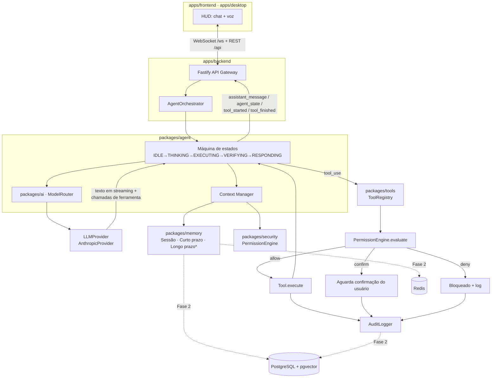

# JARVIS — Personal AI Operating System

## Documento de Arquitetura

Este documento cobre as Etapas A–E pedidas antes da implementação: análise
arquitetural, stack tecnológica, diagrama do sistema, estrutura de pastas e
comunicação entre módulos. A Etapa F (início do MVP) está implementada neste
repositório a partir da Fase 1 do roadmap (seção 9).

---

## A. Análise arquitetural

### A.1 Natureza do sistema

O JARVIS não é um chatbot: é um **sistema operacional de IA pessoal**
composto por processos independentes que se comunicam por eventos e por um
contrato de ferramentas comum. Três propriedades guiam todas as decisões
abaixo:

1. **Composabilidade** — cada capacidade (voz, memória, ferramentas, agentes
   especializados) é um módulo com interface própria, plugável e testável
   isoladamente. Nada depende de detalhes internos de outro módulo.
2. **Substituibilidade** — provedores externos (LLM, STT, TTS, wake word,
   busca) ficam atrás de interfaces (`LLMProvider`, `SpeechToTextProvider`,
   `TextToSpeechProvider`, `WakeWordProvider`). Trocar de fornecedor nunca
   deve exigir tocar no núcleo do agente.
3. **Segurança por padrão** — nenhuma ferramenta executa sem passar por
   `PermissionEngine` + `AuditLogger`. Isso é modelado no núcleo desde a Fase
   1, mesmo com apenas uma ferramenta de baixo risco disponível, para que o
   caminho crítico já esteja testado quando ferramentas perigosas (Fase 5)
   forem adicionadas.

### A.2 Domínios do sistema

| Domínio | Responsabilidade | Pacote |
|---|---|---|
| Interface | Chat + voz, HUD, estado do agente em tempo real | `apps/frontend`, `apps/desktop` (futuro) |
| Orquestração | API HTTP/WebSocket, ciclo de vida da requisição | `apps/backend` |
| Agente | Máquina de estados, loop objetivo→plano→ação→verificação | `packages/agent` |
| IA | Abstração de LLMs, roteamento de modelos | `packages/ai` |
| Memória | Sessão, curto prazo, longo prazo, semântica | `packages/memory` |
| Ferramentas | Contrato de tools, registro, execução | `packages/tools` |
| Segurança | Permissões, validação de comandos, auditoria | `packages/security` |
| Dados | Acesso a Postgres/pgvector/Redis (Fase 2+) | `packages/database` |
| Observabilidade | Logging estruturado, métricas | `packages/observability` |
| Compartilhado | Tipos e contratos usados por todos os pacotes | `packages/shared` |

### A.3 Por que essa separação

Sem essa fronteira, um projeto deste tamanho (58 seções de requisitos)
degenera rapidamente em um monólito onde "consertar a voz" quebra "a
memória". Ao isolar por domínio com interfaces explícitas, cada fase do
roadmap (seção 57) vira literalmente "implementar um pacote novo e plugá-lo
no orquestrador", sem reescrever o que já funciona.

---

## B. Stack tecnológica

### B.1 Linguagem e runtime

**TypeScript de ponta a ponta (Node.js no backend, React no frontend).**
Único ecossistema de tipos compartilhados entre agente, ferramentas e UI —
um `ToolDefinition` ou um `WSEvent` definido em `packages/shared` é o mesmo
tipo usado pelo backend e pelo frontend, sem duplicação nem drift. Módulos de
IA/ML pesados que fizerem mais sentido em Python (ex.: um modelo local de
STT) são isolados como **microsserviços chamados por HTTP/stdio**, nunca
importados diretamente — mantém o núcleo em um único runtime.

### B.2 Backend — Fastify

| Opção | Motivo da escolha / rejeição |
|---|---|
| **Fastify (escolhido)** | Baixo overhead, plugin system maduro (`@fastify/websocket`, `@fastify/cors`), validação via schema nativa, ótimo para I/O concorrente (múltiplas chamadas de LLM + ferramentas em paralelo). |
| Express | API mais simples, porém sem tipagem nativa forte e com WebSocket menos integrado; performance inferior sob carga. |
| NestJS | Estrutura excelente para times grandes, mas o overhead de DI/decorators não se paga para um agente que já tem sua própria orquestração de módulos. |

### B.3 Banco de dados — PostgreSQL + pgvector + Redis

| Opção | Motivo |
|---|---|
| **PostgreSQL (escolhido)** | Único banco relacional que cobre dados estruturados (usuários, tarefas, projetos) **e** busca vetorial (via `pgvector`) sem precisar de um segundo banco dedicado a embeddings. Menos peças móveis, transações ACID reais para auditoria. |
| **pgvector (escolhido para memória semântica)** | Evita operar um banco vetorial separado (Pinecone/Weaviate/Qdrant) só para memória semântica; embeddings vivem ao lado dos dados que descrevem, com `JOIN` normal. Suficiente até a escala de um único usuário/família. |
| **Redis (escolhido)** | Cache de contexto quente, pub/sub para eventos entre processos (necessário quando o Voice Pipeline virar um processo separado na Fase 3), armazenamento de sessões de curta duração. |
| MongoDB | Sem transações relacionais fortes nem vetor nativo maduro; rejeitado. |
| SQLite | Ótimo para protótipo local, mas sem `pgvector` real e sem boa concorrência de escrita; mantido apenas como opção de fallback 100% offline documentada, não como padrão. |

### B.4 Frontend — React + TypeScript + Tailwind + Vite

Vite para dev server instantâneo e HMR; Tailwind para o design system HUD
(seção 28) sem CSS solto se acumulando; Zustand para estado global leve
(mensagens, estado do agente, sessão de voz) — dispensa a cerimônia do
Redux para o tamanho deste app.

### B.5 Desktop — Tauri (escolhido) vs Electron

| Critério | Tauri | Electron |
|---|---|---|
| Tamanho do instalador | ~3–10 MB (usa o WebView do SO) | ~80–150 MB (empacota Chromium) |
| RAM em repouso | Baixa (sem Chromium próprio) | Alta (processo Chromium completo) |
| Acesso ao SO (controle do computador, seção 18) | Camada Rust com permissões explícitas por comando — modelo de segurança mais estrito, alinhado à seção 20 | Node.js com acesso irrestrito por padrão; exige disciplina manual para não expor APIs perigosas ao renderer |
| Maturidade do ecossistema | Boa e crescendo; algumas libs nativas Node não portam direto | Muito madura; qualquer pacote npm funciona |

**Decisão: Tauri.** O agente literalmente controla o computador do usuário
(seção 18–20) — o modelo de permissões explícitas do Tauri (cada comando
nativo é declarado e autorizável) casa diretamente com o `PermissionEngine`
que já estamos construindo, em vez de lutar contra o modelo "tudo liberado"
do Electron. O custo é reescrever, quando chegar a Fase 10, algumas
integrações nativas em Rust — aceitável, pois o núcleo de produto
(`apps/backend`, `packages/*`) continua 100% TypeScript e é apenas
*hospedado* pelo shell Tauri.

### B.6 IA — camada de provedores

`LLMProvider` é uma interface própria (não um wrapper fino do SDK de um
fornecedor). A primeira implementação real é **Anthropic Claude**
(`AnthropicProvider`, em `packages/ai`), usando os modelos:

- `claude-haiku-4-5-20251001` — tarefas rápidas/baratas (saudações, factual curto)
- `claude-sonnet-5` — modelo padrão de conversação e uso de ferramentas
- `claude-opus-5` — planejamento complexo, análise de projeto inteiro, arquitetura

O `ModelRouter` (seção 37) decide qual desses usar por requisição. Novos
provedores (OpenAI, Google, modelo local via Ollama) só precisam implementar
`LLMProvider` — nada no `AgentOrchestrator` muda.

### B.7 Voz (interfaces prontas desde já, implementação na Fase 3)

`SpeechToTextProvider`, `TextToSpeechProvider` e `WakeWordProvider` são
interfaces definidas em `packages/ai` desde a Fase 1 (contratos estáveis),
mesmo sem implementação concreta ainda. Plano de implementação na Fase 3:

- **Wake word**: local (openWakeWord / Porcupine) — precisa rodar sempre
  ligado, então tem que ser offline e leve.
- **VAD**: local (`@ricky0123/vad-web` ou `webrtcvad` no processo nativo).
- **STT**: local por padrão (`whisper.cpp` via processo separado) com opção
  de fallback em nuvem para maior precisão.
- **TTS**: provedor em nuvem por padrão (voz mais natural), com opção local
  (Piper) para modo 100% offline.

### B.8 Resumo da stack

```
Linguagem:        TypeScript (Node.js 22+ / React 18+)
Backend:          Fastify + @fastify/websocket
Banco relacional: PostgreSQL 16
Vetorial:         pgvector
Cache/pubsub:     Redis 7
Frontend:         React + Vite + Tailwind + Zustand
Desktop:          Tauri
IA (Fase 1):      Anthropic Claude (Opus 5 / Sonnet 5 / Haiku 4.5)
Voz (Fase 3):     wake word e VAD locais, STT local com fallback em nuvem, TTS em nuvem com opção local
Infra:            Docker Compose (dev), CI/CD (Fase 9+)
Testes:           Vitest
```

---

## C. Diagrama do sistema



`*` memória de longo prazo/semântica é a Fase 2; a Fase 1 usa apenas memória
de sessão em processo.

---

## D. Estrutura de pastas

```
jarvis/
├── apps/
│   ├── backend/            # Fastify: API REST + WebSocket, wiring do agente
│   ├── frontend/           # React + Tailwind: HUD de chat/voz
│   └── desktop/            # Shell Tauri (Fase 10) — vazio por enquanto
│
├── packages/
│   ├── shared/              # Tipos e contratos usados por todos os módulos
│   ├── ai/                  # LLMProvider, AnthropicProvider, ModelRouter, interfaces de voz
│   ├── agent/                # AgentOrchestrator (máquina de estados + loop de ferramentas)
│   ├── memory/               # SessionMemory (Fase 1); MemoryStore/embeddings (Fase 2)
│   ├── tools/                # Contrato Tool, ToolRegistry, ferramentas concretas
│   ├── security/             # PermissionLevel, PermissionEngine, CommandValidator, AuditLogger
│   ├── database/             # Cliente Postgres/pgvector/Redis (Fase 2)
│   └── observability/        # Logger estruturado (pino)
│
├── plugins/                 # Plugins de terceiros (Fase 9): spotify, discord, github...
│
├── database/
│   ├── migrations/           # SQL versionado (Fase 2)
│   └── seeds/                 # Dados iniciais (Fase 2)
│
├── docs/
│   └── ARCHITECTURE.md        # Este documento
│
├── data/                      # audit.log local (Fase 1), gitignored
├── docker-compose.yml         # Postgres + pgvector + Redis (usado a partir da Fase 2)
├── package.json                # Workspaces npm
├── tsconfig.base.json
├── vitest.config.ts
├── eslint.config.js
├── .env.example
└── README.md
```

Cada pacote em `packages/*` e app em `apps/*` tem seu próprio
`package.json`, `tsconfig.json` e (quando aplicável) testes em
`src/**/*.test.ts`. Pacotes internos são consumidos como workspaces npm
(`@jarvis/shared`, `@jarvis/ai`, …), resolvidos diretamente para o código
TypeScript fonte via `tsx`/Vite — sem etapa de build separada durante o
desenvolvimento.

---

## E. Como os módulos conversam

### E.1 Contrato de eventos (tempo real)

Todo evento entre backend e frontend é um `WSEvent` tipado, definido uma
única vez em `packages/shared` (seção 34):

```
user_message · assistant_message_start · assistant_message_delta ·
assistant_message_end · agent_state · tool_started · tool_finished ·
tool_confirmation_required · tool_confirmation_resolved · error
```

Eventos de voz (`transcription`, `voice_started`, `voice_finished`) e de
memória (`memory_retrieved`) já existem no tipo `WSEvent` como variantes
reservadas para a Fase 3/2, mas não são emitidos ainda — isso evita uma
ruptura de contrato quando essas fases forem implementadas.

### E.2 Fluxo de uma mensagem (texto, Fase 1)

1. `apps/frontend` envia `{type:"user_message", text}` pelo WebSocket.
2. `apps/backend` roteia para `AgentOrchestrator.handleUserMessage`.
3. O orquestrador grava a mensagem em `SessionMemory`, emite
   `agent_state: THINKING`.
4. `ModelRouter.select()` escolhe o modelo (rápido/padrão/avançado) com base
   em heurísticas sobre a mensagem.
5. `AnthropicProvider.chat()` transmite o texto em streaming
   (`assistant_message_delta`) e, se o modelo decidir usar uma ferramenta,
   retorna blocos `tool_use`.
6. Para cada `tool_use`: `PermissionEngine.evaluate()` decide
   `allow`/`confirm`/`deny`; `ToolRegistry` executa a ferramenta permitida;
   `AuditLogger` registra tudo, independentemente do resultado.
7. O resultado da ferramenta volta para o modelo como `tool_result`; o loop
   (passo 5) se repete até o modelo concluir (`end_turn`) ou até o limite de
   iterações (`AGENT_MAX_TOOL_ITERATIONS`, proteção contra loop infinito —
   seção 41).
8. A resposta final é gravada na memória de sessão e emitida como
   `assistant_message_end`; `agent_state` volta a `IDLE`.

### E.3 Regra de dependência entre pacotes

```
shared  ← security ← tools ← agent ← (apps/backend)
shared  ← observability ← (todos)
shared  ← ai ← agent
shared  ← memory ← agent
```

Nunca ao contrário: `packages/ai` não conhece `packages/tools`;
`packages/security` não conhece `packages/agent`. Isso é o que permite testar
cada pacote isoladamente (seção 49) e trocar peças sem efeito cascata.

---

## F. Roadmap de fases (referência)

| Fase | Escopo | Status |
|---|---|---|
| 1 | Core + Chat (texto, streaming, 1 ferramenta de demonstração, permissões, auditoria) | **Implementado neste commit** |
| 2 | PostgreSQL + pgvector + Redis; memória de curto/longo prazo, episódica, semântica, preferências | Planejado |
| 3 | Voice pipeline (wake word, VAD, STT, TTS, interrupção) | Planejado |
| 4 | Tool Engine completo (arquivos, terminal, programação) | Planejado |
| 5 | Controle do computador (processos, janelas, mídia) | Planejado |
| 6 | Visão computacional (screenshots, OCR) | Planejado |
| 7 | Multiagentes especializados (Research, Coding, Browser, ...) | Planejado |
| 8 | Aprendizado contínuo e feedback | Planejado |
| 9 | Sistema de plugins | Planejado |
| 10 | Desktop AI OS (Tauri) | Planejado |

Este documento e o roadmap são atualizados a cada fase concluída.
